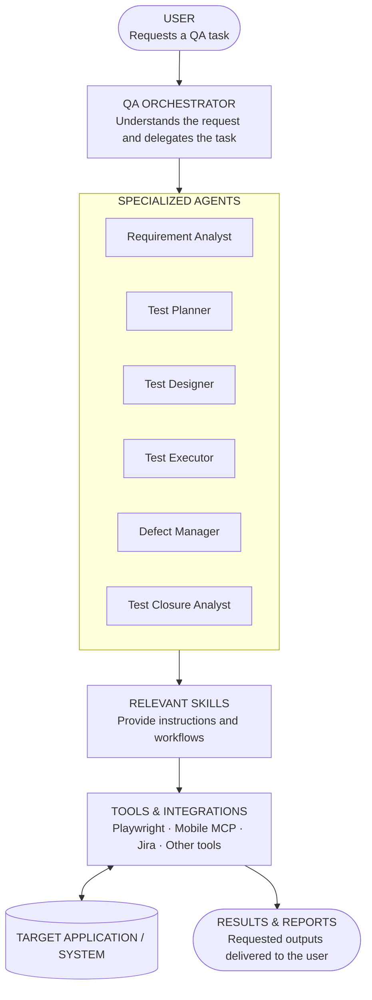

# QA Agentic Framework – Architecture

## Overview

The QA Agentic Framework receives QA requests from users, delegates tasks to specialized Agents, and uses reusable Skills and available tools to perform the requested activities.

## High-Level Architecture

## Main Components

| Component | Responsibility |
|---|---|
| User | Defines the requested QA task. |
| QA Orchestrator | Understands requests and coordinates task delegation. |
| Specialized Agents | Handle specific QA responsibilities. |
| Skills | Provide reusable instructions and workflows. |
| Tools & Integrations | Enable interaction with applications and external systems. |
| Results & Reports | Store and deliver the requested outputs. |

## Core Design Principles

- **Dynamic Discovery:** Agents and Skills are discovered when needed.
- **Task Flexibility:** Users can request independent QA activities without following a mandatory sequence.
- **Reusability:** Skills can be reused across different projects.
- **Platform Independence:** Core Agent and Skill definitions remain independent of the AI platform.
